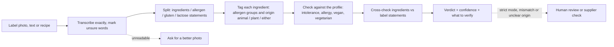
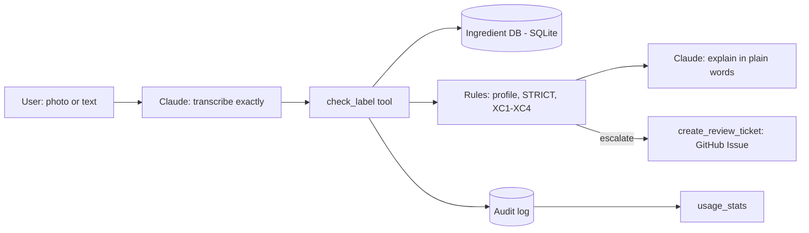

# Ingredient Lens

An AI agent that reads an ingredient list (from a label photo, typed text or a recipe) and tells you, in plain language, what matters for your restrictions: lactose, gluten, allergens, and whether each ingredient is of **animal or plant origin** (vegan and vegetarian checks). Built as a no-code agent on Claude, with the whole process documented in this repo.

> **Status:** v0.1 in progress · **Video demo:** _link coming soon_
> Independent prototype. Not affiliated with any company. Not medical, legal or regulatory advice.

## Three ways to use it
| Mode | Who | Input | Output |
|---|---|---|---|
| **Shopper** | Person with intolerances or allergies | Photo or text of one label | Short traffic-light verdict |
| **Cook** | Cook or recipe developer serving guests with restrictions (vegan, vegetarian, allergens) | Recipe ingredients (text) or product labels (photos) | Table with origin and fit per ingredient, plus what to verify with the supplier |
| **Analyst** | Regulatory or quality analyst | Label photo or text | Ingredients vs. label statements cross-check and a human-review handoff note |

## How it works


## Reproduce it for free (about 10 minutes)
1. Create a free Claude account, then **Projects → New project** (name it "Ingredient Lens").
2. Paste `agent/project-instructions.md` into the project's instructions.
3. Add the three files in `agent/knowledge/` to the project's files.
4. Open a chat inside the project. Attach a photo of an ingredient panel (1000x1000 px or larger works best) or paste a recipe, and say what you need to avoid.

## v0.2: the agent uses tools
In v0.1 the model did everything from its instructions. In v0.2 it calls an MCP server (`mcp-server/`) and only transcribes and explains:

| Tool | What it does | Why it is not left to the model |
|---|---|---|
| `check_label` | Matches each ingredient against the ingredient database, applies the profile and STRICT mode, cross-checks label statements (rules XC1-XC4) | Same input, same answer, every time; rules are tested in code |
| `lookup_ingredient` | Looks up one term in a SQLite database built from the glossaries; every row cites its source | Governed, versioned data instead of free text |
| `create_review_ticket` | Sends escalated cases to a human-review queue (GitHub Issues or a local file) | Human in the loop for contradictions and STRICT cases |
| `usage_stats` | Verdict mix, escalation rate and most frequent mismatches from the audit log | Monitoring after go-live |



**Connect it to Claude Desktop** (needs [uv](https://docs.astral.sh/uv/)): Settings → Developer → Edit Config, add the block below with your path, restart Claude Desktop, then use the Ingredient Lens project from the desktop app.
```json
{
  "mcpServers": {
    "ingredient-lens": {
      "command": "uv",
      "args": ["run", "--directory", "C:\\path\\to\\ingredient-lens\\mcp-server", "server.py"],
      "env": { "INGREDIENT_LENS_GITHUB_REPO": "your-user/ingredient-lens" }
    }
  }
}
```
Leave out `env` to keep review tickets in a local file. In Claude Code, the `.mcp.json` at the repo root connects it automatically.

**Check the rules without any LLM:** `cd mcp-server`, then `uv run pytest` and `uv run eval_rules.py` (runs the golden set's text rows through the rules engine).

## Repo map
| Path | What it is |
|---|---|
| `docs/00-project-record.html` | Living project record (BA view): activity log, decisions, traceability, metrics, risks, backlog. Open in a browser |
| `docs/01-discovery.md` | Problem, personas, current process, pain points, business relevance |
| `docs/02-tool-selection.md` | Why a Claude Project (no-code), and what would need engineering |
| `docs/03-requirements.md` | User stories, acceptance criteria, safety requirements |
| `agent/` | The agent: instructions, knowledge files, changelog |
| `mcp-server/` | v0.2 tools: rules engine, ingredient database (`data/ingredients.csv`), review queue, audit log, unit tests |
| `tests/` | Test plan, golden set (including trap cases), evidence |

## Results
- Rules engine (no LLM) vs golden set text rows: 25/25 ([results-rules-v0.2.md](tests/evidence/results-rules-v0.2.md)). The golden set was used while building the rules, so this is not yet an unbiased accuracy figure; a held-out set is next.
- _To be filled: full agent in the Claude chat (photos, tone, safety wording), v0.1 vs v0.2._

## Limitations
- Photo reading can fail on curved packs, glare and tiny print. The agent must say so instead of guessing.
- A label cannot show everything: processing aids (for example bone char used to filter some sugar) and cross-contact are usually invisible.
- Ingredient origin is often not stated (shortening, glycerin, natural flavors). The agent marks these "Can be either" and says what to check; it never guesses.
- The rules are a simplified summary. See `agent/knowledge/label-rules-br-us-eu.md` and its linked sources.
- The agent never says a product is "safe" or "vegan for sure". For allergy or celiac disease, always confirm with the manufacturer and a health professional.
