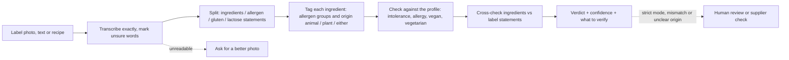

# Ingredient Lens

An AI agent that reads an ingredient list (from a label photo, typed text or a recipe) and tells you, in plain language, what matters for your restrictions: lactose, gluten, allergens, and whether each ingredient is of **animal or plant origin** (vegan and vegetarian checks). Built as a no-code agent on Claude, with the whole process documented in this repo.

> **Status:** v0.1 in progress · **Video demo:** _link coming soon_
> Independent prototype. Not affiliated with any company. Not medical, legal or regulatory advice.

## Three ways to use it
| Mode | Who | Input | Output |
|---|---|---|---|
| **Shopper** | Person with intolerances or allergies | Photo or text of one label | Short traffic-light verdict |
| **Cook** | Cook or recipe developer serving guests with restrictions (vegan, vegetarian, allergens) | Recipe ingredients (text) or product labels (photos) | Table with origin and fit per ingredient, plus what to verify with the supplier |
| **Analyst** | Regulatory or quality analyst | Label photo or text | Ingredients vs. label statements cross-check and a human-review handoff note |

## How it works

## Reproduce it for free (about 10 minutes)
1. Create a free Claude account, then **Projects → New project** (name it "Ingredient Lens").
2. Paste `agent/project-instructions.md` into the project's instructions.
3. Add the three files in `agent/knowledge/` to the project's files.
4. Open a chat inside the project. Attach a photo of an ingredient panel (1000x1000 px or larger works best) or paste a recipe, and say what you need to avoid.

## Repo map
| Path | What it is |
|---|---|
| `docs/01-discovery.md` | Problem, personas, current process, pain points, business relevance |
| `docs/02-tool-selection.md` | Why a Claude Project (no-code), and what would need engineering |
| `docs/03-requirements.md` | User stories, acceptance criteria, safety requirements |
| `agent/` | The agent: instructions, knowledge files, changelog |
| `tests/` | Test plan, golden set (including trap cases), evidence |

## Results
_To be filled after testing: recall, false alarms, origin accuracy, safety checks, v0.1 to v0.2._

## Limitations
- Photo reading can fail on curved packs, glare and tiny print. The agent must say so instead of guessing.
- A label cannot show everything: processing aids (for example bone char used to filter some sugar) and cross-contact are usually invisible.
- Ingredient origin is often not stated (shortening, glycerin, natural flavors). The agent marks these "Can be either" and says what to check; it never guesses.
- The rules are a simplified summary. See `agent/knowledge/label-rules-br-us-eu.md` and its linked sources.
- The agent never says a product is "safe" or "vegan for sure". For allergy or celiac disease, always confirm with the manufacturer and a health professional.
