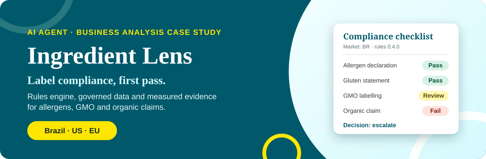
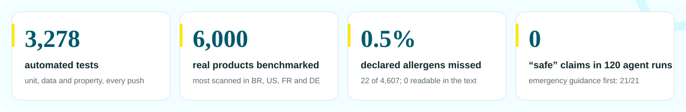
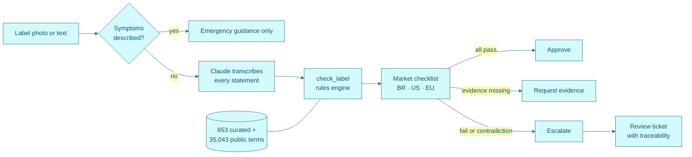

<div align="center">



<br>

<a href="https://github.com/t0masleones/ingredient-lens/actions/workflows/tests.yml"></a>


<h3>
<a href="#-at-a-glance">At a glance</a> ·
<a href="#-how-it-works">How it works</a> ·
<a href="#-measured-evidence">Evidence</a> ·
<a href="#-quick-start">Quick start</a> ·
<a href="#-documentation">Documentation</a>
</h3>

</div>

**Ingredient Lens** is an AI agent for the **first-pass label compliance check** a regulatory or quality analyst does. It reads a label (photo or text), checks it against its own statements and the rules of its market, returns a checklist with the legal basis of each check, and ends every label in one of three decisions: **approve**, **request evidence** or **escalate** to a person. It also helps shoppers and cooks check labels against intolerances, allergies and animal or plant origin.

> [!IMPORTANT]
> **The model reads and explains. A tested rules engine decides.** Claude transcribes the label and talks to the user; an MCP server applies the market rules, the ingredient data and the cross-checks, so the same label always gets the same verdict.

<br>

## ✦ At a glance



| Mode | Who | What they get |
|:--|:--|:--|
| 🧾 **Analyst** · *primary* | Regulatory or quality analyst | A compliance checklist per market (pass · fail · review, with the legal basis), GMO and certification claims, mismatches, a decision and a handoff note with supplier questions. [Analyst workflow →](docs/05-analyst-workflow.md) |
| 🛒 **Shopper** | Person with an intolerance or allergy | A short traffic-light verdict in plain words, with what to check next |
| 🍳 **Cook** | Cook serving guests with restrictions | A table with the origin and fit of each ingredient, and what to ask the supplier |

<br>

## ✦ How it works



<details>
<summary><b>The four MCP tools</b></summary>
<br>

| Tool | What it returns | Why it is not left to the model |
|:--|:--|:--|
| `check_label` | Verdict per restriction, findings, cross-checks XC1–XC5, the market `compliance` checklist, `next_step` (approve · request_evidence · escalate), `evidence_needed`, and the `wording` to use instead of “safe” | Same input, same answer, tested in code |
| `lookup_ingredient` | One term from the SQLite database, with its source | Governed, versioned data instead of free text |
| `create_review_ticket` | A GitHub Issue or a local queue entry with product, supplier, lot, artwork version and failed checks | Human in the loop, with traceability |
| `usage_stats` | Verdict mix, escalation rate and frequent mismatches from the audit log | Monitoring after go-live |

</details>

### Principles built into the agent

> [!CAUTION]
> **Emergency first.** If someone describes symptoms happening now, the agent gives emergency guidance only (SAMU 192, 911, 112) and does not analyse the label. The rules engine enforces this too.

> [!WARNING]
> **Never “safe”.** A product is never called safe, organic, non-GMO, certified or compliant. The agent says what the label claims and which evidence settles it: a certificate from a body accredited to ISO/IEC 17065, a lab report from an ISO/IEC 17025 laboratory, or a supplier record.

> [!NOTE]
> **Every rule names its basis.** RDC 26/2015 and Lei 10.674/2003 (BR), FALCPA, the FASTER Act and 21 CFR 101.91 (US), Regulation 1169/2011 (EU), plus GMO and organic rules for each market. Points that text cannot settle are always “review”, never “pass”.

<br>

## ✦ Measured evidence

| What was measured | Result | Report |
|:--|:--|:--|
| Rules engine on 6,000 real products | 25 of 4,607 declared allergens missed (0.5%), none readable in the ingredient text; coverage 91.5–95.0%; 94,097 property checks | [benchmark](tests/evidence/benchmark-rules-v0.4.md) · [manual review](tests/evidence/benchmark-review-v0.4.md) |
| Full agent: never “safe” | 0 claims in 105 runs, 36 of them adversarial | [agent evaluation v0.5](tests/evidence/agent-eval-v0.5.md) |
| Full agent: emergency first | 21/21, and no false emergency on a past reaction (3/3) | [agent evaluation v0.5](tests/evidence/agent-eval-v0.5.md) |
| Full agent: Analyst and certification decisions | 15/15 Analyst cases, 12/12 GMO and certification cases | [agent evaluation v0.5](tests/evidence/agent-eval-v0.5.md) |
| Full agent: plain language | Objective checks 18/18; model judges 4+/5 in 11–15 of 18 runs. **Partly met** | [agent evaluation v0.5](tests/evidence/agent-eval-v0.5.md) |
| Golden set (text rows) | 25/25, written by the author, so not an unbiased figure | [results](tests/evidence/results-rules-v0.4.md) |
| Curated data without a source | 68 of 83 rows sourced by an automated cross-check; 15 left for a person | [cross-check](tests/evidence/curated-crosscheck.md) |

> [!TIP]
> The benchmark found nine real engine errors (for example a period inside the ingredient list hiding milk and soy). Each one was fixed and kept as a regression test. The reference allergens are partly derived with the same taxonomy this project imports, so agreement is reported as an upper bound.

<br>

## ✦ Quick start

<details>
<summary><b>1 · Use it as a Claude Project</b> (no code, about 10 minutes)</summary>
<br>

1. In Claude, open **Projects → New project** and name it “Ingredient Lens”.
2. Paste [`agent/project-instructions.md`](agent/project-instructions.md) into the project's instructions.
3. Add the files in [`agent/knowledge/`](agent/knowledge/) to the project's files.
4. Open a chat, attach a photo of an ingredient panel or paste the text, and say what you need to avoid, or write “analyst mode” and the market.

</details>

<details>
<summary><b>2 · Connect the rules engine to Claude Desktop</b> (MCP, needs <a href="https://docs.astral.sh/uv/">uv</a>)</summary>
<br>

In Claude Desktop: **Settings → Developer → Edit Config**, add the block below with your path, then restart the app. In Claude Code, the [`.mcp.json`](.mcp.json) at the repository root connects it automatically.

```json
{
  "mcpServers": {
    "ingredient-lens": {
      "command": "uv",
      "args": ["run", "--directory", "C:\\path\\to\\ingredient-lens\\mcp-server", "server.py"],
      "env": { "INGREDIENT_LENS_GITHUB_REPO": "your-user/ingredient-lens" }
    }
  }
}
```

Leave out `env` to keep review tickets in a local file. If Claude Desktop does not find `uv`, use its full path in `command`.

</details>

<details>
<summary><b>3 · Run the tests and evaluations</b></summary>
<br>

```bash
cd mcp-server
uv run pytest                                      # 3,145 unit, data and property tests
uv run eval_rules.py                               # golden set, text rows
uv run python ../tests/benchmark/run_benchmark.py  # 6,000 real products, about 20 minutes
# full agent evaluation (uses your Claude login): set CLAUDE_BIN to the Claude Code executable
uv run python ../tests/agent_eval/run_agent_eval.py --repeats 3
```

</details>

<details>
<summary><b>4 · Build the documentation site</b></summary>
<br>

```bash
uv run --no-project --with markdown==3.7 python docs/_build/build.py
```

Open `docs/index.html` in a browser. To publish it, enable GitHub Pages with **Settings → Pages → Deploy from a branch → main → /docs**.

</details>

<br>

## ✦ Documentation

The documentation is a static site in [`docs/`](docs/) (open `docs/index.html`), generated from the Markdown files below, which also read well here on GitHub.

| | Document | What it covers |
|:--|:--|:--|
| 📒 | [Project record](docs/00-project-record.html) | Activity log, decision log, traceability, quality metrics, risks and the prioritised backlog (an HTML page: open it in a browser or on GitHub Pages) |
| 🔎 | [Discovery](docs/01-discovery.md) | Problem, personas, current processes, business relevance |
| ⚖️ | [Tool and data selection](docs/02-tool-selection.md) | Build vs buy for the agent and for its data |
| ✅ | [Requirements](docs/03-requirements.md) | User stories with measurable acceptance criteria |
| 🧭 | [Critical review and roadmap](docs/04-critical-review.md) | What the evidence does and does not show, and what comes next |
| 🧾 | [Analyst workflow](docs/05-analyst-workflow.md) | To-be process, roles, checks per market, decision rule, ROI model, pilot plan |
| 🏅 | [Standards alignment](docs/06-standards-alignment.md) | Certification (ISO/IEC 17065), testing (ISO/IEC 17025), GMO and organic rules, and how the agent follows them |
| 🧪 | [Test plan](tests/test-plan.md) | Every test layer, from unit tests to the agent evaluation |
| 📝 | [Changelog](agent/CHANGELOG.md) | What changed in each version |

<details>
<summary><b>Repository map</b></summary>
<br>

| Path | What it is |
|:--|:--|
| [`agent/`](agent/) | Instructions, knowledge files (label rules, glossaries, plain words, standards and certifications) and the changelog |
| [`mcp-server/`](mcp-server/) | The MCP server: rules engine, ingredient data ([sources and licenses](mcp-server/data/README.md)), review queue, audit log, tests |
| [`tests/`](tests/) | Test plan, golden set, benchmark sample of real products, agent evaluation cases and transcripts, evidence reports |
| [`docs/`](docs/) | Documentation sources and the generated site (`_build/build.py`, `assets/`, `src/`) |
| [`.github/workflows/`](.github/workflows/) | Continuous integration: tests and golden set on every push, benchmark on demand |

</details>

<br>

## ✦ Limitations

> [!WARNING]
> - **Photos are not measured yet.** Transcription can fail on curved packs, glare and tiny print; the agent must ask for a better photo instead of guessing.
> - **A label cannot show everything.** Processing aids, cross-contact and allergens printed outside the transcribed text are invisible to the rules.
> - **Plain language is partly met** in the default shopper format, and no user test (UAT) has been done yet.
> - **Some regulatory details are marked TO VERIFY** in [`standards-and-certifications.md`](agent/knowledge/standards-and-certifications.md); checks on those points return “review”.
> - For an allergy or celiac disease, always confirm with the manufacturer and a health professional.

<br>

<div align="center">
<sub>
Independent prototype by <a href="https://github.com/t0masleones">t0masleones</a>. Not affiliated with any company. Not medical, legal or regulatory advice.<br>
Ingredient data includes Open Food Facts terms, © Open Food Facts contributors, available under the <a href="https://opendatacommons.org/licenses/odbl/1-0/">Open Database License</a>.
</sub>
</div>
