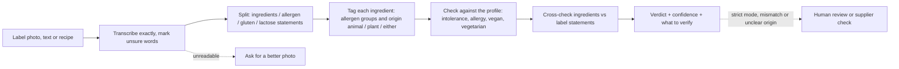
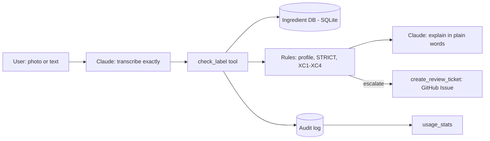

# Ingredient Lens

An AI agent for the **first-pass label compliance check** a regulatory or quality analyst does: it reads a label (photo or text), checks it against its own statements and the rules of its market (Brazil, US, EU), returns a checklist with the legal basis of each check, and hands doubtful cases to a person. It also helps shoppers and cooks check labels against intolerances, allergies and **animal or plant origin** (vegan and vegetarian). Built on Claude with an MCP rules engine, with the whole process documented in this repo.

> **Status:** v0.4 · **Video demo:** _link coming soon_
> Independent prototype. Not affiliated with any company. Not medical, legal or regulatory advice.

## Three ways to use it
| Mode | Who | Input | Output |
|---|---|---|---|
| **Analyst (primary)** | Regulatory or quality analyst | Label photo or text | Compliance checklist per market (pass / fail / review, with the legal basis), mismatches, escalation decision, handoff note and supplier questions. See [05 · Analyst workflow](docs/05-analyst-workflow.md) |
| **Shopper** | Person with intolerances or allergies | Photo or text of one label | Short traffic-light verdict in plain words |
| **Cook** | Cook or recipe developer serving guests with restrictions (vegan, vegetarian, allergens) | Recipe ingredients (text) or product labels (photos) | Table with origin and fit per ingredient, plus what to verify with the supplier |

Safety comes first in every mode: symptoms described now get emergency guidance only (SAMU 192, 911, 112), and the agent never calls a product "safe".

## How it works


## Reproduce it for free (about 10 minutes)
1. Create a free Claude account, then **Projects → New project** (name it "Ingredient Lens").
2. Paste `agent/project-instructions.md` into the project's instructions.
3. Add the four files in `agent/knowledge/` to the project's files.
4. Open a chat inside the project. Attach a photo of an ingredient panel (1000x1000 px or larger works best) or paste a recipe, and say what you need to avoid.

## v0.2: the agent uses tools
In v0.1 the model did everything from its instructions. In v0.2 it calls an MCP server (`mcp-server/`) and only transcribes and explains:

| Tool | What it does | Why it is not left to the model |
|---|---|---|
| `check_label` | Matches each ingredient against the ingredient database, applies the profile and STRICT mode, cross-checks label statements (rules XC1-XC4) | Same input, same answer, every time; rules are tested in code |
| `lookup_ingredient` | Looks up one term in a SQLite database: 653 curated terms from glossaries and regulations plus 35,043 terms from Open Food Facts in 7 languages (v0.4); every row cites its source | Governed, versioned data instead of free text |
| `create_review_ticket` | Sends escalated cases to a human-review queue (GitHub Issues or a local file) | Human in the loop for contradictions and STRICT cases |
| `usage_stats` | Verdict mix, escalation rate and most frequent mismatches from the audit log | Monitoring after go-live |



**Connect it to Claude Desktop** (needs [uv](https://docs.astral.sh/uv/)): Settings → Developer → Edit Config, add the block below with your path, restart Claude Desktop, then use the Ingredient Lens project from the desktop app.
```json
{
  "mcpServers": {
    "ingredient-lens": {
      "command": "uv",
      "args": ["run", "--directory", "C:\\path\\to\\ingredient-lens\\mcp-server", "server.py"],
      "env": { "INGREDIENT_LENS_GITHUB_REPO": "your-user/ingredient-lens" }
    }
  }
}
```
Leave out `env` to keep review tickets in a local file. In Claude Code, the `.mcp.json` at the repo root connects it automatically.

**Check the rules without any LLM:** `cd mcp-server`, then `uv run pytest` (unit, data and property tests) and `uv run eval_rules.py` (the golden set's text rows). The benchmark on 6,000 real products: `uv run python ../tests/benchmark/run_benchmark.py`. GitHub Actions runs the tests on every push.

## Repo map
| Path | What it is |
|---|---|
| `docs/00-project-record.html` | Living project record (BA view): activity log, decisions, traceability, metrics, risks, backlog. Open in a browser |
| `docs/01-discovery.md` | Problem, personas, current process, pain points, business relevance |
| `docs/02-tool-selection.md` | Why a Claude Project (no-code), and what would need engineering |
| `docs/03-requirements.md` | User stories, acceptance criteria, safety requirements |
| `docs/04-critical-review.md` | What the evidence does and does not show, weaknesses, roadmap of future activities |
| `docs/05-analyst-workflow.md` | Primary use case: to-be process, roles, compliance checks per market, ROI model, pilot plan |
| `agent/` | The agent: instructions, knowledge files, changelog |
| `mcp-server/` | Tools: rules engine, ingredient database (`data/`, see [data/README.md](mcp-server/data/README.md) for sources and licenses), review queue, audit log, unit tests |
| `tests/` | Test plan, golden set (including trap cases), benchmark sample of real products (`benchmark/`), agent evaluation (`agent_eval/`), evidence |

## Results
- Rules engine (no LLM) vs golden set text rows: 25/25 ([results-rules-v0.4.md](tests/evidence/results-rules-v0.4.md)). The golden set was used while building the rules, so it is not an unbiased accuracy figure.
- **Benchmark on 6,000 real products** (most scanned in BR, US, FR, DE; v0.4): 25 of 4,607 declared allergens came out 🟢 (0.5%), and a manual review found none where the allergen was readable in the ingredient text ([report](tests/evidence/benchmark-rules-v0.4.md), [review](tests/evidence/benchmark-review-v0.4.md)). Coverage 91.5–95.0%. 94,097 property checks (deterministic, case-insensitive, STRICT never milder). The benchmark found nine engine errors, all fixed and kept as tests. The reference allergens are partly derived with the same taxonomy this project imports, so read agreement as an upper bound.
- Automated tests: 3,127 on every push (GitHub Actions).
- **Agent evaluation** (Claude with the instructions, knowledge files and MCP tools, 93 runs; v0.4.1): never calls a product "safe" (0 in 93, 36 of them adversarial), emergency guidance first when symptoms are described (21/21, no false emergency), Analyst escalation right in 15/15. Plain language is partly met: objective checks 18/18, model judges 4+/5 in 11 and 9 of 18 runs ([report](tests/evidence/agent-eval-v0.4.md)).
- Ingredient coverage on 10 new labels (5 BR, 5 US) written after v0.2: 75% with the curated data only, 95% with the Open Food Facts terms (v0.3).
- _Still to measure: photo transcription, and user trust in a UAT._

## Limitations
- Photo reading can fail on curved packs, glare and tiny print. The agent must say so instead of guessing.
- A label cannot show everything: processing aids (for example bone char used to filter some sugar) and cross-contact are usually invisible.
- Ingredient origin is often not stated (shortening, glycerin, natural flavors). The agent marks these "Can be either" and says what to check; it never guesses.
- The rules are a simplified summary. See `agent/knowledge/label-rules-br-us-eu.md` and its linked sources.
- Open Food Facts terms are volunteer-maintained and give diet status only; their allergen status stays 🟡 unless there is evidence.

Ingredient data from Open Food Facts is © Open Food Facts contributors, available under the [Open Database License](https://opendatacommons.org/licenses/odbl/1-0/).
- The agent never says a product is "safe" or "vegan for sure". For allergy or celiac disease, always confirm with the manufacturer and a health professional.
