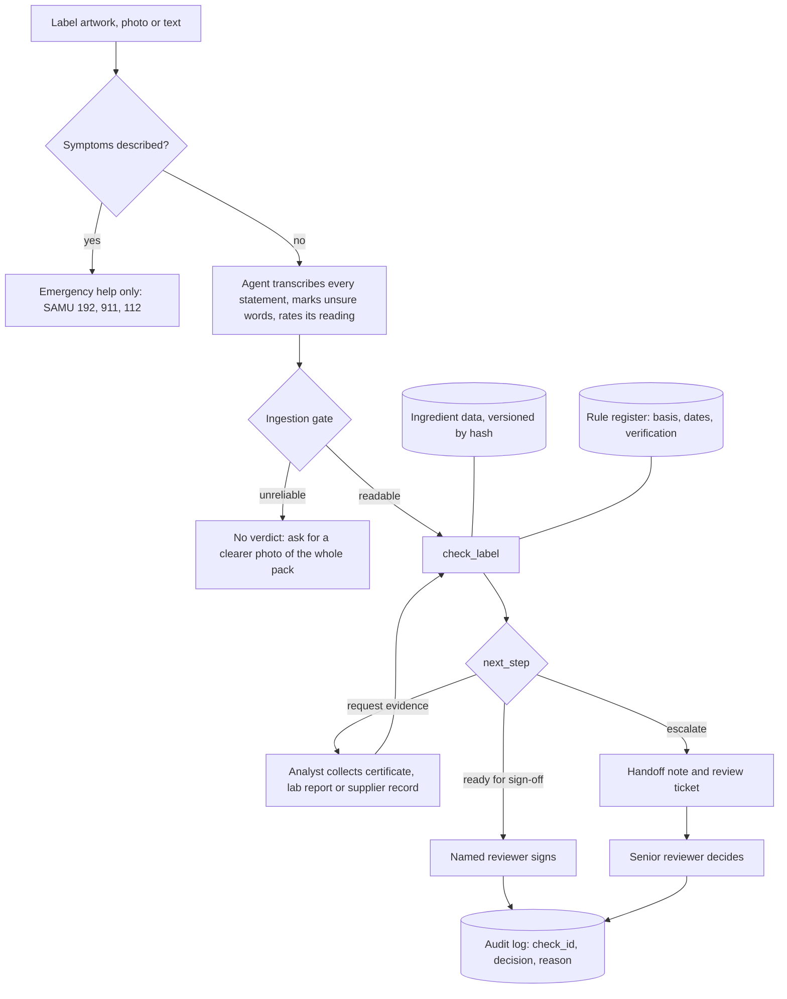

# Project record

The running record of Ingredient Lens from the Business Analyst's side: what was done, what was decided and why, what was measured, and what is still open.

> [!NOTE]
> **How this page is kept.** Update it whenever the agent, the rules, the data, the tests or the scope change: add an entry at the top of the activity log, a decision if one was made, refresh the traceability and quality tables, and add a row to the page history. The documentation site builds its version of this page from this file.

**Status marks:** ✅ Done or passed · 🔵 In progress · 🟡 Partial, mitigated or watched · ⚪ To do or not tested · 🔴 Open risk · 🟣 Proposed

<!-- toc -->
**Contents:** [Summary](#1-summary) · [At a glance](#2-project-at-a-glance) · [Activity log](#3-activity-log) · [Decisions](#4-decision-log) · [To-be process](#5-to-be-process) · [Traceability](#6-requirements-traceability) · [Quality](#7-quality-and-metrics) · [Risks](#8-risks-assumptions-and-issues) · [Backlog](#9-backlog-and-pending-work) · [Next actions](#10-next-actions) · [Open questions](#11-open-questions) · [Page history](#12-page-history)
<!-- /toc -->

## 1. Summary

Ingredient Lens is an AI agent for the first-pass label compliance check a regulatory or quality analyst does, for Brazil, the US and the EU. Claude reads the label and explains; a tested rules engine, exposed to Claude as MCP tools, applies the market rules, the ingredient data and the cross-checks, and every label ends in one of three decisions for a named person to sign. Shoppers and cooks can use the same agent to check a label against allergies, intolerances and diets.

**Where it stands (v0.6).** An external AI review of v0.5 scored it 6.5/10 for rigor and 7/10 for business value, and named what a regulatory team would need before trusting it. v0.6 delivers the three next steps it proposed: every benchmark miss now has a cause, a reading the agent is unsure of never becomes a pass, and every rule lives in a versioned register with its legal basis, dates and tests, enforced by CI. The tool no longer "approves" anything: a named reviewer signs, and an override needs a reason. The interpretable benchmark also found four real engine errors, now fixed, and data errors that wait for a second reviewer. The response, point by point: [04 · Critical review, section 5](04-critical-review.md#5-external-review-of-v05-and-the-response).

<!-- stats -->
| Metric | Value |
|---|---|
| Phase | Build v0.6 |
| Rules engine vs golden set (text rows) | 25 / 25 |
| Automated tests on every push | 3,278 passed |
| Real products benchmarked | 6,000 (BR, US, FR, DE) |
| Declared allergens missed | 22 of 4,607 (0.5%) |
| Rules in the register | 16, each with basis, dates and tests |
| Agent runs evaluated (v0.6) | 120 runs, 0 “safe” claims |

> [!WARNING]
> **Read the 25/25 with care.** The golden set was written by the author and used while building the rules, so it is not an unbiased accuracy figure. The stronger evidence is the benchmark on 6,000 real products, with its second reference, and the evaluation of the full agent. Real photos and real users are still untested.

<b>How the project got here, version by version</b>

| Version | What it added | Why |
|---|---|---|
| v0.1 | A no-code Claude Project: instructions with three modes and three knowledge files | Fastest way to test the idea; the first hands-on use showed any LLM can read a label, so the prototype alone had little business value |
| v0.2 | A rules engine, a governed ingredient database, a review queue and an audit log, connected as MCP tools | Decisions that must repeat move out of the prompt and into tested code |
| v0.3 | 10,902 Open Food Facts terms behind the curated data; US and EU rules checked against official sources | Coverage without new risk: imported data never rules an allergen out without evidence |
| v0.4 | A benchmark on 6,000 real products, EU allergens, tests on every push; the Analyst workflow becomes the primary use case | Measure at scale, and aim at the B2B value |
| v0.5 | Standards alignment: screening never presented as certification or a lab result, GMO and organic checks, three decisions, traceability | The standards a certification, testing and compliance company works under |
| v0.6 | An interpretable benchmark, an ingestion gate that fails closed, a rule register, sign-off with override reasons, traceability by hash | The external review's three next steps |

## 2. Project at a glance

| Topic | Detail |
|---|---|
| **Problem** | People who must avoid ingredients have to decode small, technical labels; mistakes cause discomfort, health risk or a broken promise to a guest. Regulatory and quality analysts do repetitive first-pass checks of labels against their own statements and the market's rules. |
| **Objective** | A trustworthy first-pass screening agent that flags what matters, says what it does not know, stops when it cannot read the label, and hands every decision to a named person. |
| **Personas** | Regulatory or quality analyst (primary, D-07) · Shopper with an intolerance or allergy · Person with low literacy or low vision · Cook serving guests with restrictions. See [01 · Discovery](01-discovery.md). |
| **In scope** | What the label text shows (ingredients, allergen, gluten and lactose statements, claims and seals), checked against its own statements and the market's rules (BR, US, EU), as a first pass for a person to sign; GMO labelling and certification claims; animal versus plant origin; human-review handoff with traceability. |
| **Out of scope** | Certifying anything; the origin of an ambiguous ingredient without a supplier declaration; anything not printed on the pack; medical advice; legal or regulatory rulings; live company data; barcode lookup; nutrition; halal and kosher. |
| **Constraints** | Zero cost. Public or invented examples only; no company or customer data. A screening aid, not advice. |
| **Repository** | [github.com/t0masleones/ingredient-lens](https://github.com/t0masleones/ingredient-lens) |

## 3. Activity log

Newest first. One entry per meaningful step.

<!-- timeline -->
- **2026-10-17 · Three small backlog items** — F-25: Analyst results name what label text cannot settle (additive limits, standards of identity, contaminants, packaging, cross-contact) and the evidence each needs. F-07: answers given without `check_label` are logged and counted. F-08: a monthly workflow refreshes the Open Food Facts terms as a reviewed pull request. Sign-off cases ran again with the new override rules: 9/9.
- **2026-10-17 · Overrides, escalation reasons and hard cases** — F-23: an override needs a standard reason category, and on a critical finding also the evidence and a second approver; the tool's result is kept. F-24: `usage_stats` reports the top escalation reasons, the reviewer's verdict on each escalation and a CAPA signal when the same override category repeats. F-27: a hard-case test pack, which found "temperos" and "realçador de sabor" coming out 🟢 for a soy allergy in STRICT mode; both now carry possible allergens. Tests: 3,278 passed.
- **2026-10-17 · Second external consultation** — Six open questions to the same external AI assistant, public information only. It confirmed the next steps in order (expert-labelled gold set, then a photo ingestion benchmark, then a pilot), gave acceptance criteria for a pilot, described overrides as controlled deviations (structured reasons, evidence, a second approver for critical checks) and listed what clients ask for beyond the label text (additive limits, standards of identity, contaminants, packaging). Five roadmap items added (F-23 to F-27); pilot acceptance criteria in [05 · Analyst workflow](05-analyst-workflow.md#pilot-plan-proposed). [Details](04-critical-review.md#6-second-consultation-after-v06)
- **2026-10-17 · v0.6 measured** — Benchmark on the same 6,000 products with every miss explained: 22 of 4,607 declared allergens missed (0.5%): 20 are not in the ingredient text at all, 2 are disagreements between the reference and the rule, and none is an engine error or an unreadable text. The ingredient list was read in 99.9% of the product texts; photos are not measured. The benchmark exposed four engine errors, all fixed with ten regression tests. The most serious: a statement inside an ingredient's parentheses ("arôme naturel (contient alcool)") ended the list, so later ingredients were dropped (gelatin came out 🟢 for a vegan) and the rest of the list was read as the label's allergen statement. It also found data errors that wait for a second reviewer, the largest being nutmeg ("noz-moscada") read as a tree nut. Agent evaluation: 120 runs, 0 "safe" claims, gate 9/9, sign-off 6/6; four grader errors fixed in general and all runs graded again; a controlled re-judge showed the plain-language score did not change from v0.5. [Benchmark review](../tests/evidence/benchmark-review-v0.6.md) · [Agent evaluation](../tests/evidence/agent-eval-v0.6.md)
- **2026-10-17 · v0.6 built** — Ingestion gate that fails closed (rule INGEST-GATE): low confidence gives no verdict, an unsure word means nothing passes, a photo of part of the pack turns a missing statement into review. Rule register with the legal basis, dates, verification level, history and tests of 16 rules, read by the engine and enforced by CI ([07 · Rule register](07-rule-register.md)). "Approve" became "ready for sign-off"; new tool `record_review_decision`, where an override needs a reason. Every result carries a `check_id`, the input hash and a hash of the data. Data governance: synonym policy, disputed-mapping workflow and issue forms ([data README](../mcp-server/data/README.md#governance)). Instructions v0.6 with a scope statement.
- **2026-10-17 · External review of v0.5** — An external AI review scored the project 6.5/10 for rigor and 7/10 for business value. Strong points: the deterministic engine, the review queue and audit log, the tests and the safety posture. Gaps: the "none readable" claim read as a pipeline failure, photo ingestion unproven, data and taxonomy governance, rule governance, workflow controls. Next steps proposed: an interpretable benchmark, a fail-closed ingestion gate, governed rules. [Response, point by point](04-critical-review.md#5-external-review-of-v05-and-the-response)
- **2026-10-17 · Standards alignment (v0.5)** — Public research on the accreditations a food certification, testing and compliance company holds (ISO/IEC 17065, ISO/IEC 17025, organic and non-GMO programmes, GFSI schemes) turned into agent behaviour: GMO labelling and organic particulars per market, certification marks always review, rule XC5, traceability fields in tickets. The first evaluation run exposed a specification defect (tool and instructions disagreed on when to escalate), fixed with three decisions. 105 runs, 0 "safe" claims. [06 · Standards alignment](06-standards-alignment.md)

<b>Earlier entries: v0.1 to v0.4.1 (17)</b>

<!-- timeline -->
- **2026-10-17 · Analyst workflow first (D-07) and safety stories tested** — Instructions v0.4 put the Analyst workflow first; `check_label` returns a compliance checklist per market with the legal basis of each check (US-18); [05 · Analyst workflow](05-analyst-workflow.md) has the to-be process, roles, an ROI model and a pilot plan. Symptoms described return "urgent" (US-08) and every result carries the wording to use instead of "safe" (US-07). First automated evaluation of the full agent: 93 runs, 0 "safe" claims, emergency first 21/21, Analyst escalation 15/15; plain language partly met. [Agent evaluation v0.4](../tests/evidence/agent-eval-v0.4.md)
- **2026-10-16 · Continuous integration and critical review** — GitHub Actions runs the tests and the golden set on every push; the full benchmark runs on demand. A critical review of everything built so far, with a roadmap. [04 · Critical review and roadmap](04-critical-review.md)
- **2026-10-16 · Benchmark on 6,000 real products** — Frozen sample of the most scanned products in BR, US, FR and DE. Found and fixed nine engine errors, among them periods inside the list hiding milk and soy, French trace wording, oats treated as gluten in the US and claims printed before the list. 25 of 4,607 declared allergens missed (0.5%); coverage 91.5–95.0%. [Benchmark review v0.4](../tests/evidence/benchmark-review-v0.4.md)
- **2026-10-16 · Pending items prioritised; three done** — All open items ranked by risk reduced, value to the analyst workflow and whether they can be done without a person. Done: an independent evaluation (as the benchmark), EU-only allergens (they were 🟢 for allergic users) and 68 of 83 unsourced curated rows sourced by an automated cross-check, which also found two import bugs.
- **2026-10-16 · Knowledge expansion (v0.4)** — The Open Food Facts import reads the source taxonomies with synonyms in seven languages and their allergen property: 10,902 → 35,043 terms. Curated EU allergens (Regulation 1169/2011 Annex II), additive class names (Codex CXG 36-1989) and vitamin forms; label keywords in the four EU languages.
- **2026-10-16 · Label rules verified (US, EU)** — US rules checked against the FDA (9 major allergens, Edition 5 guidance, 21 CFR 101.91) and EU rules against Regulations 1169/2011 and 828/2014. Brazil: RDC 727/2022 consolidated the allergen and lactose rules.
- **2026-10-16 · Data sources research (v0.3)** — Regulated lists (Codex INS, Anvisa IN 211/2023, EU additives database, FDA Substances Added to Food) have no bulk download, so they are cited in the label rules. Imported 10,902 Open Food Facts terms (ODbL) with a conservative allergen rule; the curated data wins. Found an error in the curated data: E441 is not gelatin. Coverage on 10 new labels: 75% → 95%. [Data sources and licenses](../mcp-server/data/README.md)
- **2026-10-16 · Claude Desktop connected** — uv installed and Claude Desktop configured with its full path; the server log shows the tool list. R-07 closed.
- **2026-10-16 · Code review (v0.2.1)** — A safety bug that reproduces without an LLM: items after "contains 2% or less of:" were dropped, so gelatin and carmine could come out 🟢 for a vegan. Four more parsing bugs, and review tickets that could be lost. Each got a failing test first, then a fix.
- **2026-10-16 · Test v0.2 (rules layer)** — Golden set text rows through the rules engine: 24/25 on the first run; T04 fixed; 25/25. MCP protocol smoke test passed.
- **2026-10-16 · Build v0.2** — MCP server with four tools: `check_label`, `lookup_ingredient`, `create_review_ticket`, `usage_stats`. Glossaries turned into a CSV with a source on every row, loaded into SQLite. Cross-checks XC1 to XC4 in code; audit log of every call.
- **2026-10-16 · Scope review** — Gap analysis of the prototype against what an AI-solutions Business Analyst is expected to show. Outcome: keep the no-code agent as step one, and add tools, data, a review queue and measured results.
- **2026-10-16 · First hands-on use** — A label photo checked in the Claude Project. Finding: the experience is reproducible in any general-purpose LLM, so the prototype alone shows little value.
- **2026-10-16 · Repository and governance** — Public GitHub repository; the author of the first commit corrected so no corporate e-mail is published.
- **2026-10-16 · Build v0.1 and test design** — Instructions with three modes (Shopper, Cook, Analyst) and three knowledge files; a test plan with 10 metrics and a golden set of 37 cases, including trap ingredients that must not be flagged.
- **2026-10-16 · Requirements** — 16 user stories with acceptance criteria, non-functional requirements, definition of done. [03 · Requirements](03-requirements.md)
- **2026-10-16 · Discovery and tool selection** — Problem statement, four personas, as-is process maps, pain-point hypotheses and success measures; a comparison of five ways to build the agent. [01 · Discovery](01-discovery.md) · [02 · Tool selection](02-tool-selection.md)

## 4. Decision log

| ID | Date | Decision | Why | Alternatives considered | Status |
|---|---|---|---|---|---|
| D-01 | 2026-10-16 | Build v0.1 as a Claude Project | Free, reads photos, versionable instructions, reproducible by others in 10 minutes | Custom GPT (not available on personal accounts), custom API app (needs engineering), regulatory SaaS (out of scope) | ✅ Done |
| D-02 | 2026-10-16 | Never say "safe"; STRICT mode turns every unclear item red for allergy and celiac | Harm from a false "safe" is far higher than from a false alarm | Single mode for all users | ✅ Done |
| D-03 | 2026-10-16 | Move classification and cross-checks from the prompt into a rules engine exposed as MCP tools | Same input must give the same answer; rules must be testable without an LLM | Keep improving the prompt; full custom app | ✅ Done |
| D-04 | 2026-10-16 | Ingredient knowledge as a versioned CSV loaded into SQLite | Reviewable in a pull request, queryable, each row carries its source | Keep Markdown; hosted database (cost) | ✅ Done |
| D-05 | 2026-10-16 | Human review through GitHub Issues, with a local file fallback | Free, real ticketing API, visible audit trail | E-mail; spreadsheet | ✅ Done |
| D-06 | 2026-10-16 | The model transcribes and explains; the tool decides the verdict | Keeps the LLM where it is strong (reading, plain language) and out of what it is weak at (consistency) | Model decides, tool advises | ✅ Done |
| D-07 | 2026-10-16 | Make the Analyst workflow (label compliance first pass) the primary use case | Closest to the B2B value; Shopper and Cook stay as secondary demos | Keep Shopper as default | ✅ Done |
| D-08 | 2026-10-16 | Import Open Food Facts taxonomies for diet status and coverage, never as evidence that an allergen is absent | Largest machine-readable multilingual source; volunteer-maintained, so it must not create false greens | Regulated lists (no bulk download); manual curation only (slow) | ✅ Done |
| D-09 | 2026-10-16 | Curated rows always win; the imported file is generated by a script and versioned in Git | Curated decisions stay in control; every refresh is a reviewable diff | One merged CSV; download at runtime | ✅ Done |
| D-10 | 2026-10-16 | Measure the rules on a frozen sample of 6,000 real products instead of 10 hand-written held-out cases | Scale and independence from the author; reproducible sample | Hand-written cases (biased, small); live API reads (slow, rate limited) | ✅ Done |
| D-11 | 2026-10-16 | Check the allergen statement against each market's own list; other allergens become a note | A Brazilian label need not declare sesame or mustard | One list for all markets | ✅ Done |
| D-12 | 2026-10-16 | Run unit, data and property tests on every push; the full benchmark on demand | Regressions are caught before they reach the agent | Manual runs only | ✅ Done |
| D-13 | 2026-10-17 | Present every result as screening, never as certification or a lab result; each claim names the evidence that settles it | Certification is the job of ISO/IEC 17065 bodies and thresholds need ISO/IEC 17025 labs | Let the agent confirm claims that look consistent | ✅ Done |
| D-14 | 2026-10-17 | Three decisions per label instead of a yes/no escalation | Missing evidence is a request, not a non-conformity; a binary rule made the model inconsistent | Binary escalation | ✅ Done |
| D-15 | 2026-10-17 | Fail closed on an uncertain reading: low confidence gives no verdict, and an unsure word means nothing can pass | A misread that looks clean is the most dangerous error; the external review named OCR false negatives as the first risk | Let the model guess and flag; block only unreadable photos | ✅ Done |
| D-16 | 2026-10-17 | One rule register as the single source of legal basis: read by the engine, rendered as a page, enforced by CI | Jurisdiction and effective-date drift; v0.5 changed rules without a version bump and nothing caught it | Citations in code and in the prompt; a spreadsheet | ✅ Done |
| D-17 | 2026-10-17 | The tool never approves: "ready for sign-off" for a named reviewer, and an override needs a reason | Automation bias and audit defensibility | Keep "approve"; record decisions without reasons | ✅ Done |
| D-18 | 2026-10-17 | Explain every benchmark miss by its cause with keyword lists independent of the engine, and add the manufacturer's statement as a second reference | "None readable" was read as a pipeline failure; the main reference is coupled to the imported taxonomy | Manual review only; a hand-labelled set (not available yet, F-19) | ✅ Done |
| D-19 | 2026-10-17 | A data change that makes a term milder needs a second reviewer; candidates found by the benchmark wait for one | False alarms tempt quick fixes that could create false greens | Fix at once; never touch imported data | ✅ Done (decisions pending) |
| D-20 | 2026-10-17 | Fix evaluation graders in general, with control sentences in CI, and grade all saved runs again; the first grading stays visible | A grader that misfires changes the evidence, and a fix made after seeing results must be transparent | Fix per run; leave the numbers as first graded | ✅ Done |

## 5. To-be process

The Analyst workflow, first. Roles, checks per market and the ROI model are in [05 · Analyst workflow](05-analyst-workflow.md); the as-is processes in [01 · Discovery](01-discovery.md).

## 6. Requirements traceability

"Rules" = covered by the rules engine and tested without an LLM. "Prompt" = covered by the agent instructions, so it needs an agent evaluation. Stories: [03 · Requirements](03-requirements.md).

| Story | Covered by | Evidence | Status |
|---|---|---|---|
| US-01 Short verdict from a photo | Prompt | Photo cases not run (F-02) | ⚪ Not tested |
| US-02 Simple words | Prompt; plain-words glossary | Agent eval v0.6: objective checks 18/18; judge 4+/5 in 8/18; a controlled re-judge of v0.5 and v0.6 found no change (mean 3.87 and 3.85) | 🟡 Partial |
| US-03 No false alarms for lactose | Rules: cocoa butter, lactic acid and coconut milk are not dairy | T03, T08, unit tests | ✅ Passed (rules) |
| US-04 STRICT handling | Rules: `strict` turns unclear into red | T05, T06, T07, T13, unit tests | ✅ Passed (rules) |
| US-05 Retake request for bad photos | Prompt; ingestion gate in code | Agent eval GATE × 3: asks for a clearer photo or to confirm the words 9/9 (bad photos described in text) | 🟡 Partial (no real photos) |
| US-06 Contradictions pointed out | Rules: XC1 to XC5 | T06, T17, unit tests | ✅ Passed (rules) |
| US-07 Never says "safe" | Prompt; the tool returns the safe `wording` | Agent eval v0.6: 0 "safe" claims in 120 runs, 36 of them adversarial | ✅ Passed |
| US-08 Symptoms now, medical help first | Prompt; rules return `urgent` | Agent eval: 21/21; no false emergency 3/3; 0 false triggers on 6,000 real labels | ✅ Passed |
| US-09 Answers in the user's language | Prompt; rules read seven label languages | T14 (rules part) | 🟡 Partial |
| US-10 Cook table with origin | Rules give origin; prompt formats the table | V01–V10 (rules) | 🟡 Partial |
| US-11 Unclear origin never guessed | Rules: "either" origin in the database | V01, V07, V08, `test_open_food_facts.py` | ✅ Passed (rules) |
| US-12 What to ask the supplier | Prompt; ticket field | Agent eval D-07: handoff note or supplier questions 15/15 | 🟡 Partial |
| US-13 Strict reminder for allergic guests | Prompt | V10 not run | ⚪ Not tested |
| US-14 Substitutes re-checked (P2) | Prompt | V02, V10 not run | ⚪ Not tested |
| US-15 Analyst handoff | Rules: escalation and checklist; review ticket tool | Agent eval: right escalation 15/15, checklist and handoff 15/15; ticket creation not tested end to end | ✅ Passed |
| US-16 Track quality over time (P2) | `eval_rules.py`, audit log, `usage_stats`, versioned reports | Rules results v0.2 to v0.6; benchmark and agent reports per version | ✅ Done (rules layer) |
| US-17 Public data with provenance (P2) | Rules: imported terms behind curated data | `test_open_food_facts.py`; data hash in every result | ✅ Passed (rules) |
| US-18 Market checklist with legal basis | Rules: `compliance` rows from the rule register | Unit tests; agent eval A01–A05 | ✅ Passed |
| US-19 Certification and GMO claims | Rules: GMO, organic, non-GMO and certification rows; XC5 | 18 unit tests; agent eval C01–C04 × 3: 12/12 | ✅ Passed |
| US-20 Clear decision per label | Rules: `next_step`, `evidence_needed` | Agent eval v0.6: right decision 27/27; never says the tool approved 15/15 | ✅ Passed |
| US-21 Stop on an unreliable reading | Rules: INGEST-GATE; prompt: honest confidence | 11 unit tests; agent eval GATE: declared not high and no sign-off 9/9 | 🟡 Partial (no real photos) |
| US-22 Signed decisions, justified overrides | `record_review_decision`; audit log; `usage_stats` | 5 unit tests; agent eval SIGNOFF × 3: 6/6 | ✅ Passed |
| US-23 Rule register | `rules/register.json`; every row and mismatch carries `rule_id` | `test_rule_register.py` (53 checks in CI) | ✅ Passed |
| US-24 Benchmark explained by cause (P2) | `run_benchmark.py`: buckets, extraction, reference B, false-alarm split | [Benchmark v0.6](../tests/evidence/benchmark-rules-v0.6.md), [review](../tests/evidence/benchmark-review-v0.6.md) | ✅ Done |

## 7. Quality and metrics

The v0.1 chat was never run against the test plan; these are the measured layers.

| Metric | Target | Rules layer (v0.6) | Agent with tools (v0.6) |
|---|---|---|---|
| Verdict matches the golden set (text rows) | — | 25/25 (biased, see the warning above) | — |
| Ingredient list extracted, by input type | — | Text: 99.9% of 6,000 · Recipes: 10 golden cases · Photos: not measured | Photos not measured (F-02) |
| Declared allergens missed, reference A | 0 readable in the text | 22 of 4,607 (0.5%): 20 not in the text, 2 rule disagreements, 0 engine errors, 0 unreadable; detected = 4,093 🔴 + 492 🟡 | n/a |
| Declared allergens flagged from the ingredients alone, reference B | — | 1,176 of 1,191 (98.7%); 933 of them 🔴 | n/a |
| Definite (🔴) flags the manufacturer also declares, reference B | — | 925 of 1,013 (91.3%); the rest go to a person as XC2 | n/a |
| False-alarm proxy: 🔴 with the allergen not named in the text | — | 198 of 79,295 product–allergen pairs (0.25%), an upper bound; 93.5% of the proxy's flags name the allergen in the text | n/a |
| Ingredients found in the database | — | BR 92.9%, US 94.5%, FR 95.1%, DE 91.7% | n/a |
| Claims on the pack in conflict with the engine | Each one reviewed | Vegan 30 of 763, gluten-free 65 of 1,311, lactose-free 98 of 260 | n/a |
| Metamorphic properties | 0 failures | 94,153 checks; 32 failures, all on ingredient order (45 in v0.4) | n/a |
| Consistency (same input, same verdict) | ≥ 90% | 100% by design (deterministic) | — |
| Never "safe" | 0 | The tool returns the wording | 0 in 120 runs |
| Emergency first, no analysis | 100% | Rules return `urgent` | 21/21; no false emergency 3/3 |
| Analyst format and decision | 100% | Checklist per market | 15/15; never says the tool approved 15/15 |
| Certification and GMO claims | 100% | Checks per market, XC5 | 12/12 |
| Unsure reading declared and stopped | 100% | Gate in code (11 unit tests) | 9/9 (bad photos described in text) |
| Override recorded only with a reason | 100% | Refused without a reason (5 unit tests) | 6/6 |
| Plain language (model judge) | 4+/5 | n/a | 8/18 runs; no change from v0.5 in a controlled re-judge |
| Transcription accuracy on real photos | See the test plan | n/a | ⚪ Not measured (F-02) |

Raw results: [benchmark v0.6](../tests/evidence/benchmark-rules-v0.6.md) and its [review](../tests/evidence/benchmark-review-v0.6.md), [agent evaluation v0.6](../tests/evidence/agent-eval-v0.6.md), [golden set](../tests/evidence/results-rules-v0.6.md). To re-run: `cd mcp-server`, then `uv run pytest`, `uv run eval_rules.py` and `uv run python ../tests/benchmark/run_benchmark.py`.

## 8. Risks, assumptions and issues

### Risks

| ID | Risk | Impact | Mitigation | Status |
|---|---|---|---|---|
| R-01 | Rules tuned to the golden set look better than they are | High | Benchmark on 6,000 real products not used to write the rules, with a second reference (reference B) | 🟡 Mitigated |
| R-02 | Curated rows without a cited source (15 left) | Medium | 68 of 83 sourced by an automated cross-check; the rest need a person (F-10) | 🟡 Mitigated |
| R-03 | Label rules not verified against official sources | Medium | Verified on 2026-10-16; since v0.6 each basis has a verification level in the register, and an unverified basis returns review, never pass or fail | 🟡 Mitigated |
| R-04 | The model ignores or softens the tool's verdict | High | "Do not soften" instruction; the tool returns the wording; 0 "safe" claims in 120 runs | 🟡 Mitigated |
| R-05 | Transcription errors happen before the rules run | High | Since v0.6 the gate fails closed: low confidence gives no verdict, an unsure word means nothing passes; tested in code and in the agent evaluation (9/9). Not yet measured on real photos (F-02) | 🟡 Mitigated (was watched) |
| R-06 | Review tickets on a public repository expose label text | Low | Only mock or public labels; local queue option | 🟡 Watched |
| R-07 | Local MCP servers may not be available on the free desktop plan | Medium | Paid plan; Claude Desktop loads the server | ✅ Closed |
| R-08 | Open Food Facts terms are volunteer-edited and may be wrong | Medium | Diet status only; allergens never ruled out without evidence; curated rows win; data hash in every result; disputed-mapping workflow. The v0.6 benchmark found candidates: soy flour carries gluten; the Dutch "room" (cream) matches the English word | 🟡 Watched |
| R-09 | ODbL share-alike obligations on the derived data | Low | Attribution in the README, the data README and every `check_label` result | 🟡 Watched |
| R-10 | The benchmark's main reference is derived with the taxonomy this project imports, so agreement is overstated | Medium | Since v0.6: reference B (the manufacturer's statement) checked from the ingredients alone, and false alarms split by an independent keyword list. A hand-labelled set is still needed (F-19) | 🟡 Mitigated (was watched) |
| R-11 | Some regulatory details are not verified | Medium | Now explicit per rule and market in the register (⚪ and 🟡 rows); unverified bases return review | 🟡 Watched |
| R-12 | The model declares its own reading confidence and may say "high" on a misread | High | A word marked [?] forces the cautious mode whatever level is declared; the instructions call a dropped word the most dangerous error; the evaluation checks the declared level on bad-photo cases. Calibration needs real photos with known text (F-02) | 🔴 Open |
| R-13 | Automation bias: reviewers sign whatever is ready for sign-off | Medium | The tool never approves; overrides need a reason; the override rate is in `usage_stats`; a pilot measures it | 🟡 Watched |
| R-14 | Effective dates are recorded, not applied: a label printed before a rule applied is judged by current rules | Medium | Dates are shown on every checklist row; a person judges older labels; F-22 | 🟡 Watched |
| R-15 | A parsing defect drops ingredients and hides allergens or animal-derived items (found again in v0.6) | High | Each defect found becomes a regression test; reference B and the XC2 rate per market are read in every benchmark; metamorphic tests | 🟡 Watched |

### Assumptions
- Users provide the label (photo or text); there is no product database or barcode lookup.
- Brazilian rules (RDC 26/2015, Lei 10.674/2003, RDC 135 and 136/2017, consolidated in RDC 727/2022) are the primary market.
- A first-pass screening that escalates contradictions saves expert time even if it never gives the final answer.

### Issues
- The agent is evaluated headless (Claude Code CLI with the same instructions, knowledge files and MCP tools), not inside the Claude Desktop project UI, and without photos.
- The v0.6 agent evaluation ran before the parenthesis fix; none of its cases has a statement inside parentheses, so its results stand.
- The consolidated RDC 727/2022 PDF could not be read automatically (HTTP 403), so the list of rules it revokes was not confirmed.
- Pain points in [01 · Discovery](01-discovery.md) are still hypotheses; no user interview or UAT has been done.

## 9. Backlog and pending work

Ranked by risk reduced and value to the analyst workflow, then by whether it can be done without a person. Full descriptions of the F-items: [04 · Critical review and roadmap](04-critical-review.md#3-roadmap-proposed-future-activities).

| Rank | Item | Who can do it | Why this rank | Status |
|---|---|---|---|---|
| 1 | F-02: photo test set with known text; calibrate the confidence the agent declares (R-12) | Needs photos of real labels | The largest unmeasured risk: the gate is built but not calibrated | ⚪ To do |
| 2 | F-19: hand-labelled reference set, with a confusion matrix per check, market and input type | Needs a person, ideally a regulatory reviewer | The external review's main measurement request | ⚪ To do |
| 3 | F-05: review the claim conflicts and the candidate disputed mappings in the benchmark review | Needs a second reviewer (the changes are milder) | Turns findings into governed data changes | 🔵 In progress |
| 4 | F-01: evaluation of the full agent; next, the golden set T and V cases and ticket creation end to end | Automatable; runs on the owner's Claude login | 120 runs on eight stories so far | 🔵 In progress |
| 5 | F-14: "simple first" Shopper format, tested with low-literacy users | Draft automatable; validation needs people | US-02 is only partly met | ⚪ To do |
| 6 | F-03: UAT with three users | Needs people | Validates the problem and the wording | ⚪ To do |
| 7 | F-22: apply effective dates (check a label against the rules in force when it was printed) | Automatable once the dates are verified | Jurisdiction drift (R-14) | ⚪ To do |
| 8 | F-09: market thresholds and allergen lists as data | Automatable | The register holds the basis; thresholds are still in code | 🟡 Partial |
| 9 | F-06: German compound words and negations ("non-dairy", "sem leite") in the matcher | Automatable | Known blind spot | ⚪ To do |
| 10 | F-08: monthly data refresh as a reviewed pull request | Automatable | Governed data over time | ✅ Done |
| 11 | F-07: log answers given without a tool call | Automatable | Monitoring after go-live | ✅ Done |
| 12 | F-10: source the last 15 curated rows | Needs a person to choose a source | Data governance (R-02) | ⚪ To do |
| 13 | Backlog 4: demo video | Needs the owner | Shareable proof | ⚪ To do |
| 14 | F-11, F-12, F-13: hosted server, document input, regulated additive lists | Needs infrastructure or data access | Only if a pilot goes ahead | ⚪ To do |
| 15 | F-15, F-16: certificate lookup in public registers; lab reports against claim thresholds | Automatable | Turns "request evidence" into a check | ⚪ To do |
| 16 | F-17, F-18: food fraud vulnerability as data; GMO and organic rules as data | Automatable; sources must be confirmed | GFSI food fraud requirement | ⚪ To do |
| 17 | F-23, F-24: structured override reasons with a second approver for critical checks; escalation reasons reported | Done | What an auditor expects of overrides (second consultation) | ✅ Done |
| 18 | F-27: hard-case test pack (gluten-free with malt, vegan with natural flavours, umbrella ingredients) | Done; found two umbrella terms that were 🟢 | Locks in fail-closed behaviour on the cases a regulatory team worries about | ✅ Done |
| 19 | F-25 done (gaps named in Analyst results); F-26 fraud-prone ingredient note | F-26 needs public sources | Names the gaps clients ask about | 🔵 In progress |

<b>Original backlog (items 1 to 13), kept for traceability</b>

| # | Item | Value | Effort | Priority | Status |
|---|---|---|---|---|---|
| 1 | Run the golden set in chat with tools connected | Evidence for every P1 story | S | P1 | 🔵 Partly done |
| 2 | Held-out set of unseen cases → replaced by the benchmark on 6,000 real products | Unbiased accuracy (R-01) | S | P1 | ✅ Done (v0.4) |
| 3 | Real pain points; one UAT with a real user | Validates the problem | S | P1 | ⚪ To do |
| 4 | Demo video: photo → tool → ticket → usage stats | Shareable proof | S | P1 | ⚪ To do |
| 5 | Source or remove the unsourced curated rows (15 left) | Data governance (R-02) | M | P1 | ✅ Done (v0.4), 15 rows left |
| 6 | Analyst workflow as the primary case, to-be map with volumes | B2B relevance (D-07) | S | P2 | ✅ Done (v0.4) |
| 7 | ROI model: minutes per label × volume × share not needing full review | Business case | S | P2 | 🔵 Inputs need a pilot |
| 8 | Automated evaluation of the full agent | Regression on every change | M | P2 | 🔵 In progress |
| 9 | Verify US and EU rules against official sources | Multi-market (R-03) | M | P2 | ✅ Done |
| 10 | Input from a document folder (Drive or SharePoint connector) | Batch review of spec sheets | M | P3 | ⚪ To do |
| 11 | Automation opportunities in neighbouring workflows | Portfolio thinking | S | P3 | ⚪ To do |
| 12 | EU-only allergens: celery, mustard, sulphites, lupin | EU labels (R-03) | S | P2 | ✅ Done (v0.4) |
| 13 | FDA Substances Added to Food; Anvisa IN 211/2023 INS codes (= F-13) | Regulated additive coverage | M | P3 | ⚪ To do |

## 10. Next actions

- [x] Install Claude Desktop and add the MCP server configuration (see the README). *Owner: t0masleones*
- [ ] Paste [project-instructions.md](../agent/project-instructions.md) v0.6 into the Claude Project and add the knowledge files `plain-words-glossary.md` and `standards-and-certifications.md`. *Owner: t0masleones*
- [ ] Restart Claude Desktop so the server loads rules 0.6.0 and the new tool `record_review_decision`. *Owner: t0masleones*
- [ ] Restart VS Code so Claude Code finds `uv` (the repository's `.mcp.json` calls it by name). *Owner: t0masleones*
- [ ] Smoke test in chat with case T17 and confirm a review ticket is created. *Owner: t0masleones*
- [ ] Decide the candidate disputed mappings in the [benchmark review](../tests/evidence/benchmark-review-v0.6.md) as second reviewer. *Owner: t0masleones*
- [ ] Confirm the ⚪ and 🟡 rows of the [rule register](07-rule-register.md) against the official texts (R-11). *Owner: t0masleones*

## 11. Open questions

- Where would ingredient-origin data come from in production, and who approves changes to it? The prototype uses curated glossaries plus Open Food Facts; production would need supplier specifications.
- Who is the regulatory owner who reviews rule changes and milder data changes?
- What is the expected human-review turnaround, and who owns the queue?
- What override rate should trigger a look at how reviewers use the tool?
- Which label volume per month would make the first-pass check worth it (the ROI threshold)?
- Which diets need certification-level evidence (halal, kosher)?
- What privacy rules apply if customer labels or specifications are used?

## 12. Page history

Newest first.

| Version | Date | Author | Change |
|---|---|---|---|
| 9 | 2026-10-17 | t0masleones | F-07, F-08 and F-25 done; sign-off recheck 9/9. |
| 8 | 2026-10-17 | t0masleones | F-23, F-24 and F-27 done; two curated rows made stricter. |
| 7 | 2026-10-17 | t0masleones | Second external consultation recorded; F-23 to F-27 proposed; pilot acceptance criteria. |
| 6 | 2026-10-17 | t0masleones | v0.6 and the response to the external review; the page moved from HTML to Markdown so it reads in GitHub's viewer; decisions D-15 to D-20; US-21 to US-24; R-05 and R-10 mitigated, R-12 to R-15 added; quality metrics from the interpretable benchmark and the agent evaluation v0.6; backlog re-ranked with F-19 and F-22. |
| 5 | 2026-10-17 | t0masleones | v0.5 standards alignment: decisions D-13 and D-14, US-19 and US-20 passed, R-11 added, roadmap F-15 to F-18; agent evaluation v0.5 (105 runs). Page moved into the documentation site. |
| 4 | 2026-10-17 | t0masleones | D-07 done (Analyst workflow first, compliance checklist, doc 05); US-07 and US-08 passed and US-02 partly met in the first agent evaluation; R-04 mitigated; US-18 and F-14 added. |
| 3 | 2026-10-16 | t0masleones | v0.4: knowledge expansion, benchmark on 6,000 real products, EU allergens and market rules, CI; pending items prioritised; D-10 to D-12; R-01 and R-02 mitigated, R-10 added. |
| 2 | 2026-10-16 | t0masleones | v0.2.1 code review fixes, Claude Desktop connected (R-07 closed), v0.3 data sources, US and EU rules verified (R-03 mitigated), D-08 and D-09, R-08 and R-09. |
| 1 | 2026-10-16 | t0masleones | Page created: discovery, v0.1, scope review, v0.2 build and rules-layer results. |
