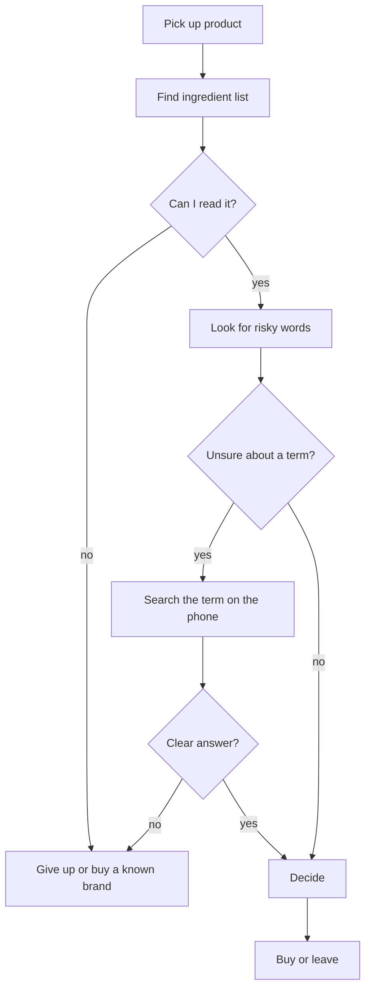
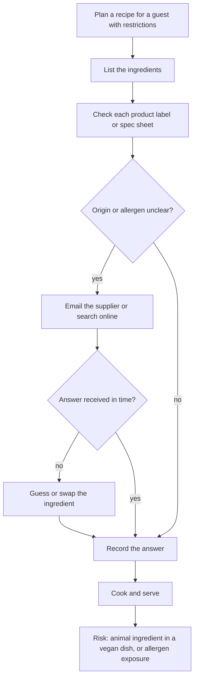

# 01 - Discovery

## Problem statement
People who must or want to avoid certain ingredients (lactose, gluten, allergens, animal-derived ingredients) have to decode small, technical ingredient lists. Mistakes cause discomfort, health risk (allergy, celiac disease) or a broken promise to a guest (a dish served as vegan that is not). Some people cannot easily read or copy long ingredient names: low literacy, low vision, or a label in a foreign language.

## Who is affected
| Persona | Need | Pain today |
|---|---|---|
| Shopper with intolerances (the author) | A quick yes / maybe / no in the aisle | Hidden sources (whey, malt), tiny print, false alarms (cocoa butter, lactic acid) |
| Person with low literacy or low vision | An answer without typing or reading long words | Cannot copy ingredient names into a search box |
| Cook or recipe developer serving guests (for example a US caterer) | Confirm that every ingredient fits vegan, vegetarian or allergen-free requests | Ingredients with unclear origin (shortening, glycerin, natural flavors), manual label checks, supplier emails |
| Regulatory or quality analyst | Check that label statements match the ingredient list | Manual, repetitive first-pass checks before expert review |

## Current process (as-is)

### Shopper

### Cook

## Pain points
Add your own real situations here (3 to 5). Examples to look for:
- TODO: a time a label was hard to read or understand
- TODO: a time a term turned out to be a false alarm
- TODO: a time a "safe" product caused discomfort

Hypotheses to validate with cooks (talk to at least one):
- Unclear origin (shortening, emulsifiers, natural flavors) is the main source of doubt, more than obvious ingredients like lard or honey.
- Cooks would accept "check with the supplier" if the agent says exactly what to ask.

## Business relevance (public information)
- FoodChain ID's Recipes & Specifications platform centralizes raw-material, formulation and labeling data with built-in regulatory checks; a published customer story describes extracting allergen data into label-ready outputs. https://www.foodchainid.com/?p=70714
- Its Regulatory Assessment tool lets users upload recipes and shows compliance in a red-yellow-green matrix. https://foodchainid.com/?p=168
- This prototype explores a lightweight, conversational first pass on a similar question: read an ingredient list, classify it, and flag what needs expert review.

This is an independent prototype. No company data or products were used.

## Success measures
- Accuracy: trigger recall and origin accuracy on the golden set (see `tests/test-plan.md`).
- Trust: the agent says when it does not know instead of guessing.
- Usefulness: a real user completes 5 cases and rates trust 4 or higher out of 5.
- Effort: time to get an answer compared with the manual process above.

## Assumptions and constraints
- Zero cost: free tools only. Nothing is deployed publicly; the demo is a screen recording.
- Labels are read from photos or text provided by the user; no barcode or product database.
- The agent is a screening aid, not medical, legal or regulatory advice.
