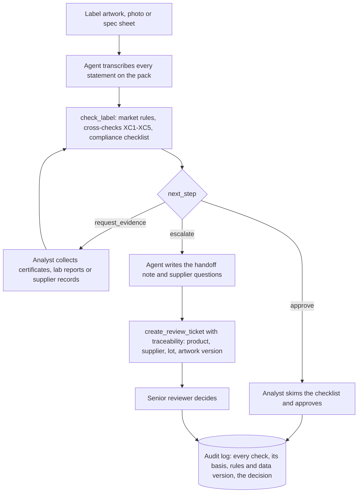

# 05 - Analyst workflow: label compliance first pass (primary use case, D-07)

## Why this is the primary use case
Shopper and Cook show the idea; the Analyst workflow is where a food company spends expert time. A regulatory or quality analyst reads every new or changed label, checks it against its own statements and the rules of each market, and sends doubtful cases to a senior reviewer or the supplier. A first pass that is repeatable, cites the legal basis of each check and says "review" when text cannot settle a point saves the reading and lookups, and keeps the decision with the expert.

## To-be process (v0.5)

| Step | Agent | Analyst | Senior reviewer |
|---|---|---|---|
| Transcribe the label, mark unsure words | Does | Checks unclear photos | — |
| Market rules and cross-checks | Does (rules engine) | Reads the checklist | — |
| Decide on a clean label | Proposes | **Decides** | — |
| Decide on a fail, review or mismatch | Writes the handoff note | Opens the ticket | **Decides** |
| Ask the supplier | Drafts the questions | Sends them | — |

## What the compliance checklist covers
Returned by `check_label` as `compliance` (status pass / fail / review / n/a, legal basis, detail). Tested in `mcp-server/tests/test_safety_and_compliance.py` and `mcp-server/tests/test_certifications.py`.

| Market | Check | Basis | What text cannot settle (always "review") |
|---|---|---|---|
| BR | Allergen declaration matches the ingredients | RDC 26/2015 (in RDC 727/2022) | Format: upper case, bold, 2 mm letters |
| BR | "CONTÉM GLÚTEN" / "NÃO CONTÉM GLÚTEN" present and consistent | Lei 10.674/2003 | — |
| BR | "CONTÉM LACTOSE" or a lactose-free claim | RDC 135/2017 and 136/2017 | The lactose amount (100 mg per 100 g threshold) |
| US | Major allergens declared | FALCPA 2004, FASTER Act 2021 | A source named in parentheses instead of a "Contains" line |
| US | Gluten-free claim | 21 CFR 101.91 | The 20 ppm limit (lab result) |
| EU | 14 allergens emphasised in the list | Regulation (EU) 1169/2011, Art. 21, Annex II | Emphasis (bold) is not visible in text |
| EU | Gluten-free claim | Regulation (EU) 828/2014 | The 20 mg/kg limit (lab result) |
| All | Vegan claim consistent with the ingredients | No legal definition in BR or the US | Processing aids, cross-contact |
| BR | GMO labelling: "transgênico" and the T symbol above 1% | Decreto 4.680/2003; Portaria 2.658/2003 | The GMO share: supplier record or PCR result |
| US | Bioengineered disclosure for listed crops | 7 CFR Part 66 | Records showing non-BE status; detectability of refined ingredients |
| EU | "Genetically modified" above 0.9% per ingredient | Regulation (EC) 1829/2003 | Adventitious presence: supplier evidence |
| BR / US / EU | Organic particulars: SisOrg seal; "Certified organic by …"; EU logo, control body code, farming origin. A missing US certifier statement or EU code is a fail | Lei 10.831/2003; 7 CFR Part 205; Regulation (EU) 2018/848 | The certificate itself (public register) |
| All | Non-GMO claims and other certification marks | Certification by ISO/IEC 17065 bodies | The certificate (body, number, scope, validity) or a PCR result |
| All | Organic claim with a declared GMO ingredient (XC5) | Organic rules exclude GMOs | — |

**Decision rule (`next_step`).** Approve when every check passes or does not apply; Request evidence when a check is "review" (the analyst collects the evidence and runs the check again); Escalate when a check fails or a mismatch exists. Standards behind it: [06 · Standards alignment](06-standards-alignment.md).

## What the benchmark says about this workflow
On the 6,000 real products, Analyst mode flags 4% of US labels, 13–18% of EU labels and 76% of Brazilian labels. The Brazilian figure is not a real escalation rate: Open Food Facts usually stores only the ingredient list, without the "ALÉRGICOS" and "CONTÉM GLÚTEN" statements, so most labels look as if those statements were missing. The lesson for the workflow: the agent must transcribe every statement on the pack, and a pilot must measure the escalation rate on complete labels.

## ROI model (to be filled with measured values)
The formula is fixed; the inputs are assumptions until a pilot measures them. Nothing below is a measured result except the model cost per label.

**Monthly analyst hours saved = L × [t_manual − (1 − e) × t_clean − e × (t_manual + t_handoff)] ÷ 60**

| Input | Meaning | Value used in the example | Source |
|---|---|---|---|
| L | Labels checked per month | 300 | Assumption: replace with the team's volume |
| t_manual | Minutes for a manual first pass | 25 | Assumption: time it with an analyst |
| t_clean | Minutes to review the agent's checklist on a clean label | 8 | Assumption: time it in the pilot |
| t_handoff | Extra minutes to read the agent's handoff on a flagged label | 5 | Assumption |
| e | Share of labels the agent flags | 20%, 30%, 40% | Assumption: the benchmark cannot give it (see above) |
| Model cost per label | Claude usage per agent run | about US$ 0.07 | Measured in the agent evaluation (`tests/evidence/agent-eval-v0.4.md`) |

| Flagged share e | Manual hours per month | Assisted hours | Hours saved | Share saved |
|---|---|---|---|---|
| 20% | 125 | 62 | 63 | 50% |
| 30% | 125 | 73 | 52 | 42% |
| 40% | 125 | 84 | 41 | 33% |

With these assumptions the model cost is about US$ 21 per month for 300 labels. The decision rule for a pilot: go ahead if measured hours saved stay above 25% with e measured on complete labels, and if no label the agent marked clean is later found non-compliant by the reviewer (the safety metric for this workflow).

## Pilot plan (proposed)
1. Pick one market and one product category; collect 50 recent labels with the reviewer's final decision (the reference).
2. Time the manual first pass on 10 of them (t_manual).
3. Run all 50 through the agent; time the analyst on the checklist (t_clean, t_handoff); measure e.
4. Compare the agent's flags with the reviewer's decisions: missed issues (must be 0), false flags (acceptable if cheap to dismiss).
5. Fill the ROI model with the measured values and decide.
